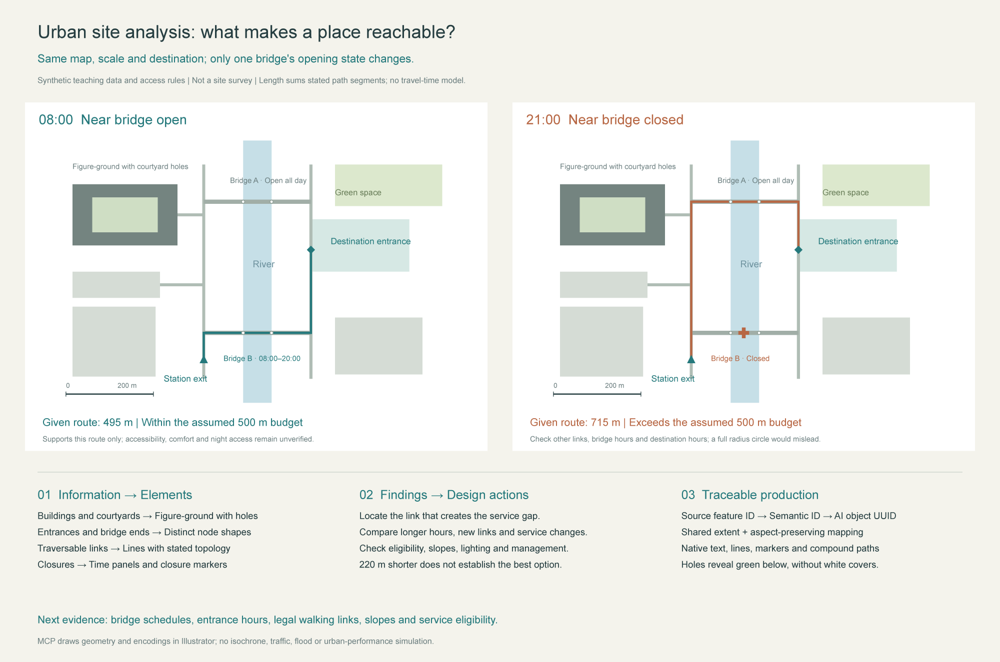

[繁體中文](README.md) · [简体中文](README.zh-CN.md) · [English](README.en.md) · [日本語](README.ja.md)

# Illustrator Architecture MCP

**`0.1.0-alpha.1` — Editable Illustrator workflows for architectural and urban analysis diagrams.**

This fork extends the general Illustrator MCP with evidence-based diagram methods, reference-image coordinate mapping, semantic overlay layers, and planar urban-data conversion. It turns “question → evidence → spatial relationship → visual encoding → design action” into editable vectors and text.

This alpha is distributed as **source code and locally installable `.tgz` archives**. It is not published to npm, the MCP Registry, or a plugin marketplace. Existing upstream packages and plugins do not install this fork. The four READMEs are maintained together; the full methodological references are currently primarily in Simplified Chinese.



*This example demonstrates visual methods and tool workflows. It is not a measured urban study or a GIS computation result.*

## What is included

- **7 architecture and urban tools**, usable alongside an existing Illustrator MCP or as part of a standalone full server.
- **9 on-demand guidance topics**, 36 building and site-analysis dimensions, 40 neighbourhood-scale analysis dimensions, and worked examples.
- Editable zones, compound regions with real holes, polylines and Bézier routes, arrows, markers, sectors, boundaries, labels, and simple hatching.
- Explicit document identity, batch IDs, sources and evidence status; style preflight, readback, and failure-recovery information.

| Tool | Purpose and relevant contract |
| --- | --- |
| `arch_read_reference` | Read an actual artboard or cropped preview, document identity, and coordinate frame |
| `arch_map_preview_points` | Convert original preview pixels to pt coordinates on a specified artboard |
| `arch_add_overlay` | Create semantic, native editable elements on a separate new layer |
| `arch_inspect_elements` | Inspect objects and semantics; may write missing identification IDs into object notes, so it is not strictly read-only |
| `arch_style_elements` | Preflight, apply supported object-style edits in batches, and read back results |
| `arch_get_diagram_guidance` | Read bundled methodology without starting Illustrator |
| `arch_prepare_site_map` | Convert explicitly projected or local planar features into aspect-preserving overlay parameters; retain source IDs and holes without modifying Illustrator |

## Installation

Requires **Node.js 22 or 24**, npm, and a client that supports local stdio MCP servers. Actual drawing also requires an installed, runnable desktop copy of Adobe Illustrator. This fork's live-app evidence comes from **Windows and Illustrator 26**. The macOS bridge is inherited from upstream but has not been live-tested for this alpha. Other Illustrator versions also remain unverified; older versions may still trigger the upstream version warning. See the [validation record](docs/VALIDATION-ALPHA.md).

### Install from source

Replace `YOUR-ACCOUNT` with the account hosting this fork, or download and extract this fork's source ZIP.

```sh
git clone https://github.com/YOUR-ACCOUNT/illustrator-architecture-mcp.git
cd illustrator-architecture-mcp
npm ci
npm run build
npm test
npm run verify:offline
```

`verify:offline` checks ESM and bundle startup, tool discovery in both modes, all 9 guidance topics, and a map-conversion fixture. It **does not start or modify Illustrator**. Dependency installation still requires the npm registry or a usable cache. Do not copy `node_modules` between operating systems.

### Install a downloaded `.tgz`

Run these commands in a new installation directory, replacing the example archive path with the actual download location:

```sh
npm init -y
npm install --omit=dev /absolute/path/illustrator-architecture-mcp-0.1.0-alpha.1.tgz
node node_modules/illustrator-architecture-mcp/scripts/verify-offline.mjs
```

This installs a local archive; it does not look up a published npm package by name. Source installations use `dist/index.js`; this method uses `node_modules/illustrator-architecture-mcp/dist/index.js`. Keep the complete runtime directory, dependencies, and bundled `skills/` for your installation method.

## Connect the MCP and its skill

| Mode | Setting | When to use it |
| --- | --- | --- |
| `standalone` (default full mode) | Omit `ILLUSTRATOR_ARCHITECTURE_ONLY` or set it to `0` | This fork provides 66 base tools and 7 added tools; avoid enabling a duplicate base server |
| `addon` | `ILLUSTRATOR_ARCHITECTURE_ONLY=1` | Expose only the 7 added tools; keep an existing Illustrator MCP for opening, saving, and exporting documents |

From the source directory, generate a single-server JSON definition with **this computer's actual paths**:

```sh
npm run config:generate -- --mode standalone --output illustrator-architecture.server.json
```

Use `--mode addon` if a base server is already configured. For a `.tgz` installation, run `node node_modules/illustrator-architecture-mcp/scripts/generate-config.mjs` with the same arguments. The generator creates a new file only; it neither overwrites an existing file nor changes client settings. Review the definition before importing it through your configuration manager. Do not commit generated definitions containing local absolute paths to a public repository.

**For CC Switch-managed installations:** first run `snapshot` using your deployed management scripts. The single maintained shared skill belongs at `~/.cc-switch/skills/architecture-diagramming`; client skill directories link to it. Do not create another copy in global `.agents/skills`. After updating the complete skill, run `manage.ps1 -Action publish`, then `-Action check`. Publish a reviewed MCP JSON through `-Action set-mcp -McpId illustrator_architecture -SpecFile <absolute-path>`. Preserve per-client enabled/disabled choices and native runtime settings. These `manage.*` scripts belong to the deployment's management layer; they are not shipped here or assumed to exist in every CC Switch installation.

For environments not managed by CC Switch, merge the MCP definition through the client's supported setup mechanism and install the complete `skills/architecture-diagramming/` folder in its supported skill location. **The README is not automatically loaded as agent instructions; configure the MCP and skill separately.** See the [paired setup guide](AGENT_SETUP.md) for detailed steps, configuration examples, and acceptance checks. Reconnect the MCP or reload skills at an appropriate time; do not automatically interrupt ongoing work.

## Workflow

1. Choose the decision the diagram must support; distinguish observations, supplied data, inferences, and proposals.
2. Read the actual reference preview. Pick points using its original pixel dimensions and convert them through the tool.
3. For map data, confirm its projection, units, and Y-axis direction before preparing parameters with `arch_prepare_site_map`.
4. Create elements on a separate layer, retain sources and a unique batch ID, and preflight style changes.
5. View the result again. Check alignment, traversable connections, occlusion, legends, and text before saving a new version and exporting.

> Analyse daytime and nighttime routes from this neighbourhood to the park. First check entrances, river crossings, and opening hours; mark missing information as unknown. Compare both periods with the same extent, scale, and legend, then create editable analysis diagrams in Illustrator.

Methodology: [building-analysis workflow](docs/DIAGRAM-METHODOLOGY.zh-CN.md) · [urban site analysis](docs/URBAN-SITE-ANALYSIS.zh-CN.md) · [geometry and execution contracts](skills/architecture-diagramming/references/mcp-execution.md).

## Alpha limits and recovery

- Walls in reference images remain pixels. There is no built-in OCR, segmentation, image-to-CAD conversion, or automatic room recognition.
- `arch_prepare_site_map` does not fetch maps, reproject data, or compute network isochrones, density, or hydrology. Ordinary longitude/latitude GeoJSON must first be converted into an explicitly defined planar coordinate system.
- Sectors, arrows, markers, and line widths are visual encodings, not sunlight, wind, pedestrian-flow, or accessibility calculations. Do not invent north orientation, scale, or quantitative results when the evidence is missing.
- `compound_zone` holes must lie strictly inside the outer ring and must not touch, intersect, or nest. It performs no geometric Boolean operations. The style tool accepts only supported objects; it does not arbitrarily edit groups or compound-path members.
- Some inspection operations add ID metadata to object notes. Serialize operations across all servers connected to the same Illustrator instance to avoid acting on an unintended document.
- If a communication failure returns `outcome_unknown:true`, read back the document, layers, and batch/object state before choosing a recovery action. Do not blindly retry writes or repeatedly invoke global undo. Local rollback is not a cross-process transaction guarantee.
- Alpha APIs and installation details may change. Passing offline checks does not establish live-app geometry, font, or export correctness.

## Development, validation, and license

```sh
npm ci
npm run build
npm test
npm run verify:offline
npm run verify:package
npm run release:check -- v0.1.0-alpha.1
```

`verify:package` audits the `.tgz` contents, installs production dependencies in a clean temporary directory, and runs offline verification. It may need network access or an npm cache and does not start Illustrator. Live-app tests are recorded separately in the [validation record](docs/VALIDATION-ALPHA.md).

When forking or contributing, retain upstream copyright, add relevant tests, and keep these four READMEs synchronized. Include the package version, OS, Illustrator version, and reproduction steps in issue reports. Based on [ie3jp/illustrator-mcp-server](https://github.com/ie3jp/illustrator-mcp-server), baseline `57c5c101a5192c61535493f39b653e6f92b8eb29` (1.10.3). This fork uses the [MIT license](LICENSE) and is not an official Adobe product.

## Sources and use notices

See [Acknowledgements](ACKNOWLEDGEMENTS.md) for the libraries, architectural and urban methods, and cases actually used, with their specific roles. It distinguishes code dependencies, methodological references, and Pinterest image research; reference sources are not presented as integrated architecture databases.

Before use, read the [Disclaimer and limitations](DISCLAIMER.md), [Upstream history](UPSTREAM.md), [Privacy notice](PRIVACY.md), and [Security reporting](SECURITY.md). These detailed notices are primarily in Traditional Chinese; the disclaimer and privacy notice also include English summaries. The software MIT license does not cover third-party maps, images, or fonts.
