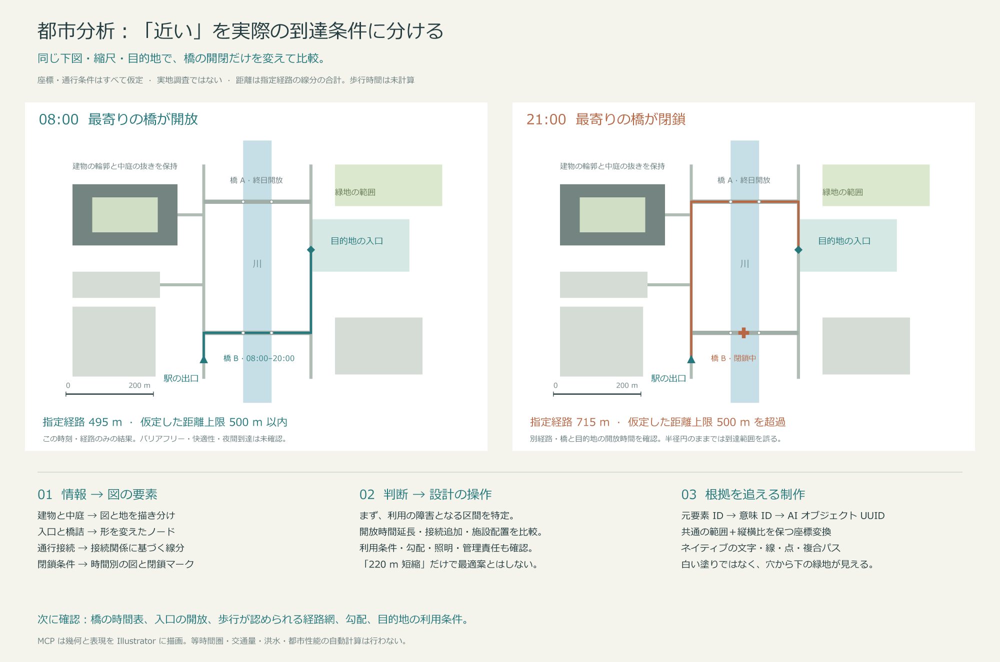

[繁體中文](README.md) · [简体中文](README.zh-CN.md) · [English](README.en.md) · [日本語](README.ja.md)

# Illustrator Architecture MCP

**`0.1.0-alpha.1` — 建築・都市分析図を編集可能な Illustrator データとして制作するワークフロー。**

この fork は、汎用 Illustrator MCP に、根拠に基づく分析方法、下図との座標対応、意味情報を持つオーバーレイレイヤー、都市の平面データ変換を追加します。「問い → 根拠 → 空間関係 → 図による表現 → 設計上の操作」を、編集可能なベクターとテキストに落とし込みます。

この alpha は [GitHub の公開 fork](https://github.com/Goku-Raku/illustrator-architecture-mcp) と [alpha Release](https://github.com/Goku-Raku/illustrator-architecture-mcp/releases/tag/v0.1.0-alpha.1) で**ソースコードとローカルインストール用の `.tgz`** を配布します。npm、MCP Registry、プラグインマーケットプレイスには公開していません。`private: true` は npm への誤公開を防ぐ設定で、公開 fork やローカルインストールを制限しません。既存の上流パッケージやプラグインでは、この fork はインストールされません。4 言語の README は同期して管理します。詳しい分析手法のリファレンスは、現在主に簡体字中国語です。



*表現方法とツールの流れを示すサンプルです。実測による都市調査や GIS の計算結果ではありません。*

ダウンロード：[インストール用 `.tgz`](https://github.com/Goku-Raku/illustrator-architecture-mcp/releases/download/v0.1.0-alpha.1/illustrator-architecture-mcp-0.1.0-alpha.1.tgz) · [ソース ZIP](https://github.com/Goku-Raku/illustrator-architecture-mcp/releases/download/v0.1.0-alpha.1/illustrator-architecture-mcp-0.1.0-alpha.1-source.zip) · [4 言語の編集可能な AI 原本と PNG](https://github.com/Goku-Raku/illustrator-architecture-mcp/releases/download/v0.1.0-alpha.1/illustrator-architecture-demo-masters-four-languages.zip) · [SHA-256 チェックサム](https://github.com/Goku-Raku/illustrator-architecture-mcp/releases/download/v0.1.0-alpha.1/SHA256SUMS.txt)。繁体字中国語・簡体字中国語・英語・日本語のデモは、すべて Illustrator で制作しています。

## 主な機能

- **建築・都市向けの 7 ツール**。既存の Illustrator MCP に追加することも、単独で全ツールを提供することもできます。
- **必要に応じて読める 9 つのガイダンストピック**、建築・敷地分析の 36 の観点、街区・地区分析の 40 の観点と具体例。
- 編集可能な領域、実際の穴を持つ複合領域、折れ線・ベジェ曲線、矢印、マーカー、扇形、境界、注釈、単純なハッチング。
- 明示的なドキュメント識別、バッチ ID、情報源、根拠の状態。スタイル変更の事前検査、変更後の読み取り、失敗時の復旧情報。

| ツール | 機能と重要な仕様 |
| --- | --- |
| `arch_read_reference` | アートボード全体または一部の実画像、ドキュメント識別情報、座標枠を取得 |
| `arch_map_preview_points` | 元のプレビュー画像のピクセル座標を、指定アートボードの pt 座標へ変換 |
| `arch_add_overlay` | 新しい独立レイヤーに意味情報を持つ編集可能なネイティブ要素を作成 |
| `arch_inspect_elements` | オブジェクトと意味情報を検査。識別 ID がない場合はオブジェクトのメモに書き込むことがあるため、厳密な読み取り専用操作ではない |
| `arch_style_elements` | 事前検査後、対応するオブジェクトのスタイルをまとめて変更し、結果を読み取り |
| `arch_get_diagram_guidance` | Illustrator を起動せず、同梱の分析手法を読み取り |
| `arch_prepare_site_map` | 投影済み／ローカル平面の地物を縦横比を保ったオーバーレイ引数へ変換。元の ID と穴を保持し、Illustrator は変更しない |

## インストール

**Node.js 22 または 24**、npm、ローカル stdio MCP に対応したクライアントが必要です。実際の作図には、インストール済みで起動可能なデスクトップ版 Adobe Illustrator も必要です。この fork の実機検証環境は **Windows と Illustrator 26** です。macOS ブリッジは上流から継承していますが、この alpha での実機検証は未実施です。他の Illustrator バージョンも未検証で、古いバージョンでは上流由来の警告が表示される場合があります。詳細は[検証記録](docs/VALIDATION-ALPHA.md)を参照してください。

### ソースコードからインストール

この公開 fork を clone するか、上記のソース ZIP をダウンロードして展開してください。

```sh
git clone https://github.com/Goku-Raku/illustrator-architecture-mcp.git
cd illustrator-architecture-mcp
npm ci
npm run build
npm test
npm run verify:offline
```

`verify:offline` は ESM／bundle の起動、両モードのツール一覧、9 つのガイダンストピック、地図変換のサンプルを確認します。**Illustrator の起動や変更は行いません。**依存関係のインストールには npm registry または利用可能なキャッシュが必要です。異なる OS 間で `node_modules` をそのままコピーしないでください。

### ダウンロードした `.tgz` からインストール

新しいインストール用フォルダーで実行し、例のパスを実際のダウンロード先に置き換えてください。

```sh
npm init -y
npm install --omit=dev /absolute/path/illustrator-architecture-mcp-0.1.0-alpha.1.tgz
node node_modules/illustrator-architecture-mcp/scripts/verify-offline.mjs
```

これはローカルのアーカイブをインストールする方法であり、公開済み npm パッケージを名前で検索するものではありません。ソース版の起動先は `dist/index.js`、この方法では `node_modules/illustrator-architecture-mcp/dist/index.js` です。各方法の実行ディレクトリ、依存関係、同梱の `skills/` を一式保持してください。

## MCP と対応 skill の設定

| モード | 設定 | 用途 |
| --- | --- | --- |
| `standalone`（既定の完全モード） | `ILLUSTRATOR_ARCHITECTURE_ONLY` を省略、または `0` | この fork が基本 66 ツールと追加 7 ツールを提供。重複する基本サーバーの同時有効化を避ける |
| `addon`（追加モード） | `ILLUSTRATOR_ARCHITECTURE_ONLY=1` | 追加 7 ツールのみを提供。ファイルを開く・保存・書き出しには既存の Illustrator MCP を使用 |

ソースディレクトリで、**使用中のコンピューターの実際のパス**を含む単一サーバー定義 JSON を生成します。

```sh
npm run config:generate -- --mode standalone --output illustrator-architecture.server.json
```

基本サーバーが設定済みの場合は `--mode addon` に変更してください。`.tgz` 版では `node node_modules/illustrator-architecture-mcp/scripts/generate-config.mjs` に同じ引数を渡します。生成処理は新規ファイルの作成のみで、既存ファイルの上書きやクライアント設定の変更は行いません。内容を確認してから設定管理ツールで取り込んでください。ローカルの絶対パスを含む生成ファイルを公開リポジトリにコミットしないでください。

**CC Switch で管理する場合：**まず、導入済みの管理スクリプトで `snapshot` を実行します。共有 skill の唯一の管理元は `~/.cc-switch/skills/architecture-diagramming` とし、各クライアントの skill フォルダーはそこへのリンクにします。グローバルの `.agents/skills` に別コピーを作成しないでください。skill 一式を更新した後、`manage.ps1 -Action publish`、続いて `-Action check` を実行します。MCP は確認済みの JSON を `-Action set-mcp -McpId illustrator_architecture -SpecFile <絶対パス>` で反映します。クライアントごとの有効／無効の選択とネイティブ実行設定を保持してください。これらの `manage.*` は導入環境の管理用スクリプトであり、本パッケージには同梱しておらず、すべての CC Switch 環境に存在するとも限りません。

CC Switch 管理外の環境では、クライアントが提供する方法で MCP 設定をマージし、`skills/architecture-diagramming/` 一式を対応する skill の場所にインストールします。**README はエージェントの操作ルールとして自動読込されません。MCP と skill は別々に設定してください。**詳しい手順、設定例、動作確認は[セットアップガイド](AGENT_SETUP.md)を参照してください。作業を中断しない適切なタイミングで MCP を再接続するか skill を再読込し、進行中の作業を自動的に再起動しないでください。

## 使用手順

1. 図で判断したい問いを選び、観察事実・提供資料・推測・提案を区別します。
2. 実際の下図プレビューを確認します。元画像のピクセル寸法で点を選び、ツールで座標を変換します。
3. 地図データを使う場合は、投影法・単位・Y 軸方向を確認し、`arch_prepare_site_map` で引数を準備します。
4. 独立レイヤーに要素を作り、出典と一意なバッチ ID を保持します。スタイル変更は事前検査から始めます。
5. 完成図を再確認し、位置合わせ・通行関係・隠れ・凡例・文字を点検してから別名保存と書き出しを行います。

> この街区から公園への昼間と夜間の経路を分析してください。まず入口、川を渡る経路、開放時間を確認し、資料不足は不明と明記してください。同じ範囲・縮尺・凡例で比較し、Illustrator で編集可能な分析図を作成してください。

分析方法：[建築分析の流れ](docs/DIAGRAM-METHODOLOGY.zh-CN.md) · [街区・地区の site analysis](docs/URBAN-SITE-ANALYSIS.zh-CN.md) · [図形と実行の仕様](skills/architecture-diagramming/references/mcp-execution.md)。

### 参考図の読み解きとスタイルの再現

画像を読み取れるエージェントと組み合わせ、Pinterest などの参考図から、構図、線幅、配色、透明度、矢印、注釈、レイヤー、平面・断面・アクソメ図の表現を読み取れます。その上で、自分のプロジェクトの情報を再構成し、Illustrator で編集可能なベクターとテキストとして制作します。流れは**参考図の観察 → 情報と図形の対応付け → スタイルの仕様化 → 制作 → 見た目と意味の照合・修正**です。まず小さなサンプルで表現を確認し、全体へ展開します。

エージェントによる解釈と作図ツールを組み合わせた手順であり、自動のワンクリック複製ではありません。複雑な 3D 形状には Rhino または既存モデルが必要で、写真やテクスチャには別途素材が必要です。画像だけでは隠れたデータや正確な計算結果は復元できません。現時点の実機検証は 4 言語のベクターデモであり、任意の Pinterest 図のスタイル再現を体系的に検証したものではありません。

## Alpha の制約と復旧

- 下図画像の壁線はピクセルのままです。OCR、画像分割、画像から CAD への変換、部屋の自動認識は内蔵していません。
- `arch_prepare_site_map` は地図取得・再投影・道路網の等時間圏・密度・水文の計算を行いません。通常の緯度経度 GeoJSON は、明示された平面座標系へ事前に変換する必要があります。
- 扇形・矢印・マーカー・線幅は表現要素であり、日照・風・歩行者流量・到達性の計算ではありません。資料がなければ北方向・縮尺・定量結果を作り出さないでください。
- `compound_zone` の穴は外周の内側に完全に収まり、互いに接触・交差・入れ子にならない必要があります。幾何のブーリアン演算は行いません。スタイルツールは対応するオブジェクトのみを受け付け、グループや複合パスの構成要素を任意には変更しません。
- 一部の検査はオブジェクトのメモに ID を追記します。同じ Illustrator に接続する全サーバーの操作を順番に行い、意図しないドキュメントへの変更を防いでください。
- 通信失敗で `outcome_unknown:true` が返った場合、ドキュメント・レイヤー・バッチ／オブジェクトの状態を読み直してから復旧方法を判断します。書き込みの無条件再試行や、全体の「取り消し」の繰り返しは避けてください。局所的なロールバックはプロセスをまたぐトランザクション保証ではありません。
- Alpha の API やインストール方法は変更される可能性があります。オフライン検査の成功だけでは、実機上の形状・フォント・書き出しの正しさを確認したことにはなりません。

## 開発・検証・ライセンス

```sh
npm ci
npm run build
npm test
npm run verify:offline
npm run verify:package
npm run release:check -- v0.1.0-alpha.1
```

`verify:package` は `.tgz` の内容を検査し、クリーンな一時ディレクトリに本番依存関係をインストールしてオフライン検証を実行します。ネットワークまたは npm キャッシュが必要な場合があります。Illustrator は起動しません。実機テストは[検証記録](docs/VALIDATION-ALPHA.md)に分けて記載します。

Fork や貢献時には上流の著作権表示を保持し、必要なテストを追加して、4 言語の README を同期してください。不具合報告にはパッケージのバージョン、OS、Illustrator のバージョン、再現手順を添えてください。[ie3jp/illustrator-mcp-server](https://github.com/ie3jp/illustrator-mcp-server) の `57c5c101a5192c61535493f39b653e6f92b8eb29`（1.10.3）を基にしています。[MIT ライセンス](LICENSE)を継承しており、Adobe 公式製品ではありません。

## 参照元と利用上の説明

実際に使用したライブラリ、建築・都市の方法論、事例とその用途は[出典・謝辞](ACKNOWLEDGEMENTS.md)を参照してください。コード依存関係、方法の参照、Pinterest の図版調査を区別しており、参照元を統合済みの建築データベースとして扱ってはいません。

要件と建築上の方向性はプロジェクトの発起人が提示し、この fork で追加したコードと文書は Codex が生成と改良を支援しました。上流の作者と第三者による貢献は、謝辞とライセンス表示に別途記載しています。

利用前に[利用範囲・免責事項](DISCLAIMER.md)、[上流との関係](UPSTREAM.md)、[プライバシー](PRIVACY.md)、[セキュリティ報告](SECURITY.md)を確認してください。詳細説明は主に繁体字中国語で、免責事項とプライバシーには英語の要約もあります。ソフトウェアの MIT ライセンスは第三者の地図・画像・フォントには適用されません。
