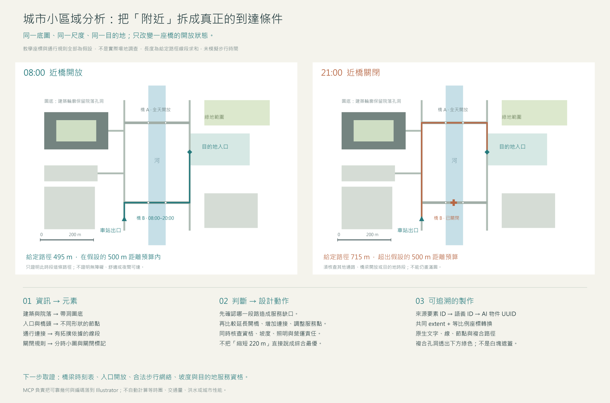

[繁體中文](README.md) · [简体中文](README.zh-CN.md) · [English](README.en.md) · [日本語](README.ja.md)

# Illustrator Architecture MCP

**`0.1.0-alpha.2` — 建築與城市分析圖的可編輯 Illustrator 工作流程。**

這個 fork 在通用 Illustrator MCP 之上，加入有證據依據的分析方法、底圖座標配準、語義覆蓋圖層與城市平面資料轉換。它協助你把「問題 → 證據 → 空間關係 → 圖形表達 → 設計動作」落實成可修改的向量與文字。

本 alpha 透過 [GitHub 公開 fork](https://github.com/Goku-Raku/illustrator-architecture-mcp) 與 [alpha Release](https://github.com/Goku-Raku/illustrator-architecture-mcp/releases/tag/v0.1.0-alpha.2) 提供**原始碼與本機安裝用 `.tgz`**；尚未上架 npm、MCP Registry 或外掛市集。`private: true` 防止誤發至 npm，不影響公開 fork 或本機安裝。現有上游套件與外掛不會安裝這個 fork。四份 README 同步維護；完整方法參考目前以簡體中文為主。



*範例用於示範表達與工具流程，不是實測城市研究或 GIS 計算成果。*

下載：[安裝包 `.tgz`](https://github.com/Goku-Raku/illustrator-architecture-mcp/releases/download/v0.1.0-alpha.2/illustrator-architecture-mcp-0.1.0-alpha.2.tgz) · [原始碼 ZIP](https://github.com/Goku-Raku/illustrator-architecture-mcp/releases/download/v0.1.0-alpha.2/illustrator-architecture-mcp-0.1.0-alpha.2-source.zip) · [四語可編輯 AI 母版與 PNG](https://github.com/Goku-Raku/illustrator-architecture-mcp/releases/download/v0.1.0-alpha.2/illustrator-architecture-demo-masters-four-languages.zip) · [SHA-256 校驗碼](https://github.com/Goku-Raku/illustrator-architecture-mcp/releases/download/v0.1.0-alpha.2/SHA256SUMS.txt)。四語演示包含繁體中文、簡體中文、英文與日語，均在 Illustrator 中製作。

## 提供什麼

- **7 個建築／城市工具**，可與既有 Illustrator MCP 搭配，也能單獨提供完整工具集。
- **9 個按需讀取的方法主題**、36 個建築與場地分析切入點、40 個城市小區域分析維度，以及完整案例。
- 可編輯的色塊、真正帶孔洞的複合區域、折線／貝茲曲線、箭頭、節點、扇形、邊界、標註與簡單斜線填充。
- 明確的文件身分、批次 ID、資料來源與證據狀態；樣式預檢、執行後讀回，以及失敗恢復資訊。

| 工具 | 功能與重要契約 |
| --- | --- |
| `arch_read_reference` | 讀取實際畫板／局部預覽、文件身分與座標框 |
| `arch_map_preview_points` | 將原始預覽像素點換成指定畫板的 pt 座標 |
| `arch_add_overlay` | 在獨立新圖層建立有語義的原生可編輯元素 |
| `arch_inspect_elements` | 檢查物件與語義；缺少識別 ID 時可能寫入物件備註，因此不是純唯讀操作 |
| `arch_style_elements` | 先預檢，再批次修改受支援物件的樣式並讀回結果 |
| `arch_get_diagram_guidance` | 讀取隨套件附帶的方法文件；不啟動 Illustrator |
| `arch_prepare_site_map` | 將已投影／本地平面要素轉成等比例覆蓋參數；保留來源 ID 與孔洞，不修改 Illustrator |

## 安裝

需要 **Node.js 22 或 24**、npm，以及支援本機 stdio MCP 的用戶端。實際繪圖另需已安裝、可開啟的桌面版 Adobe Illustrator。本 fork 的實機證據來自 **Windows 與 Illustrator 26**；macOS 橋接繼承自上游，但本 alpha 尚未實機驗收。其他 Illustrator 版本亦待驗證；較舊版本仍可能出現上游版本警告。詳細結果見[驗證紀錄](docs/VALIDATION-ALPHA.md)。

### 從原始碼安裝

複製此公開 fork，或下載上述原始碼 ZIP 後解壓縮。

```sh
git clone https://github.com/Goku-Raku/illustrator-architecture-mcp.git
cd illustrator-architecture-mcp
npm ci
npm run build
npm test
npm run verify:offline
```

`verify:offline` 檢查 ESM／bundle 啟動、兩種模式的工具列表、9 個方法主題及地圖轉換範例，**不啟動或修改 Illustrator**。安裝相依套件仍需 npm registry 或可用快取。不要跨作業系統直接複製 `node_modules`。

### 從下載的 `.tgz` 安裝

在新的安裝資料夾內執行，將範例路徑換成實際下載位置：

```sh
npm init -y
npm install --omit=dev /absolute/path/illustrator-architecture-mcp-0.1.0-alpha.2.tgz
node node_modules/illustrator-architecture-mcp/scripts/verify-offline.mjs
```

這是本機封存檔安裝，不是 npm 上架套件的名稱查詢。原始碼使用 `dist/index.js`；此方式使用 `node_modules/illustrator-architecture-mcp/dist/index.js`。保留各自完整的執行目錄、相依套件與附帶的 `skills/`。

## 連接 MCP 與配套 skill

| 模式 | 設定 | 適用情境 |
| --- | --- | --- |
| `standalone`（預設完整模式） | `ILLUSTRATOR_ARCHITECTURE_ONLY=0` 或省略 | 由本 fork 提供 66 個基礎工具與 7 個新增工具；避免同時啟用重複的基礎伺服器 |
| `addon`（附加模式） | `ILLUSTRATOR_ARCHITECTURE_ONLY=1` | 只提供 7 個新增工具；保留既有 Illustrator MCP 負責開檔、儲存與匯出 |

在原始碼目錄產生包含**這台電腦實際路徑**的單一伺服器 JSON：

```sh
npm run config:generate -- --mode standalone --output illustrator-architecture.server.json
```

已有基礎伺服器時改用 `--mode addon`。`.tgz` 安裝則執行 `node node_modules/illustrator-architecture-mcp/scripts/generate-config.mjs`，並加上相同參數。產生器只建立新檔案，不覆寫既有檔案，也不更動任何用戶端設定。檢查內容後再由設定管理員匯入；不要把含本機絕對路徑的生成檔提交到公開儲存庫。

**使用 CC Switch 管理時：**先用你部署的管理腳本執行 `snapshot`。共用 skill 的唯一維護位置是 `~/.cc-switch/skills/architecture-diagramming`，用戶端技能資料夾連結到此處；不要在全域 `.agents/skills` 再建立副本。更新完整 skill 後執行 `manage.ps1 -Action publish`，再執行 `-Action check`。MCP 使用已審閱的 JSON，經 `-Action set-mcp -McpId illustrator_architecture -SpecFile <絕對路徑>` 發布。保留各用戶端的啟用／停用選擇與原生執行設定。這些 `manage.*` 是部署者的管理層腳本，本套件不附帶，也不假定所有 CC Switch 安裝都有它們。

未採用 CC Switch 管理的環境，可透過用戶端支援的方式合併 MCP 設定，並安裝完整 `skills/architecture-diagramming/` 到其支援的技能位置。**README 不會自動載入為操作規則；MCP 與 skill 必須分別設定。**詳細步驟、設定範例與驗收方式見[配對安裝指南](AGENT_SETUP.md)。完成後在適當時機重新連接 MCP／重新載入技能，不自動中斷進行中的工作。

## 使用方式

1. 先選要判斷的問題，區分觀察、提供資料、推斷與提案。
2. 讀取真實底圖預覽；取點時使用回傳圖像的原始像素尺寸，經工具換算座標。
3. 若使用地圖資料，先確認投影、單位與 Y 軸方向，再以 `arch_prepare_site_map` 準備參數。
4. 在獨立圖層建立元素，保留來源與唯一批次 ID；修改前先預檢。
5. 重新查看圖面，檢查配準、通行關係、遮擋、圖例與文字，最後另存與匯出。

> 請分析這個街區白天與夜間到公園的路徑。先核對入口、跨河通道和開放時段；缺資料就標記未知。用同一範圍、比例與圖例比較，再用 Illustrator 建立可編輯的分析圖。

方法入口：[建築分析流程](docs/DIAGRAM-METHODOLOGY.zh-CN.md) · [城市小區域分析](docs/URBAN-SITE-ANALYSIS.zh-CN.md) · [圖形與執行契約](skills/architecture-diagramming/references/mcp-execution.md)。

### 參考圖拆解與風格復現

搭配可看圖的代理，可觀察 Pinterest 等參考圖的構圖、線寬、配色、透明度、箭頭、標註、圖層，以及平面／剖面／軸測的表達方式，再用你的專案資料重新組織，在 Illustrator 製作可編輯的向量與文字。流程是**參考觀察 → 資訊與圖形映射 → 樣式規格 → 製作 → 視覺與語義對照修正**；先用小範圍樣稿確認表達，再擴展到完整圖面。

這是代理理解與工具繪製配合的工作流程，不是自動一鍵克隆。複雜三維幾何需要 Rhino 或既有模型，照片與紋理需要額外素材；僅憑圖片不能還原隱藏資料或準確計算。現有實機證據是四語向量演示，尚未系統驗證任意 Pinterest 圖的風格復現。

## Alpha 邊界與恢復

- 圖片內的牆線仍是像素；不內建 OCR、圖像分割、圖片轉 CAD 或自動房間辨識。
- `arch_prepare_site_map` 不抓取地圖、不重投影、不計算路網等時圈、密度或水文。一般經緯度 GeoJSON 必須先轉為明確的平面座標。
- 扇形、箭頭、節點與線寬是表達元素，不是日照、風場、人流或可達性計算；沒有資料就不應補造北向、比例尺或量化結果。
- `compound_zone` 的洞必須嚴格在外框內，且互不接觸、相交或嵌套；不進行幾何布林運算。樣式工具只接受契約允許的物件，不能任意修改群組或複合路徑成員。
- 部分檢查會為物件補寫 ID 備註。所有連到同一 Illustrator 的伺服器必須循序操作，以免改到非預期文件。
- 通訊失敗若回傳 `outcome_unknown:true`，先讀回文件、圖層與批次／物件狀態，再決定如何恢復；不要直接重試寫入或反覆全域復原。局部回滾不是跨程序交易保證。
- Alpha 的 API 與安裝方式仍可能調整。離線檢查通過，不等於實機幾何、字型與輸出已驗收。

## 開發、驗證與授權

```sh
npm ci
npm run build
npm test
npm run verify:offline
npm run verify:package
npm run release:check -- v0.1.0-alpha.2
```

`verify:package` 檢查 `.tgz` 內容，並在乾淨的暫存目錄安裝正式相依套件、執行離線驗證；可能需要網路或 npm 快取。它不啟動 Illustrator。實機測試會明確分開記錄，請見[驗證紀錄](docs/VALIDATION-ALPHA.md)。

Fork 與貢獻時保留上游著作權，新增測試，並同步這四份 README；提交問題時附版本、作業系統、Illustrator 版本及可重現步驟。來源為 [ie3jp/illustrator-mcp-server](https://github.com/ie3jp/illustrator-mcp-server)，基線 `57c5c101a5192c61535493f39b653e6f92b8eb29`（1.10.3）。本 fork 採用 [MIT 授權](LICENSE)，並非 Adobe 官方產品。

## 來源與使用說明

實際採用的程式庫、建築／城市方法及案例，與各自的使用方式，見[來源與致謝](ACKNOWLEDGEMENTS.md)；其中區分程式碼依賴、方法參考與 Pinterest 閱圖，沒有把參考來源宣稱為已整合的建築資料庫。

需求與建築方向由專案發起者提出；本 fork 的新增程式碼與文件由 Codex 生成並協助迭代。上游作者與第三方來源的貢獻另列於致謝與授權文件。

使用前請閱讀[使用邊界與免責說明](DISCLAIMER.md)、[上游沿革](UPSTREAM.md)、[隱私說明](PRIVACY.md)及[安全回報](SECURITY.md)。這些詳細說明以繁體中文為主，免責與隱私文件另附英文摘要；軟體的 MIT 授權不涵蓋第三方地圖、圖片或字型。
