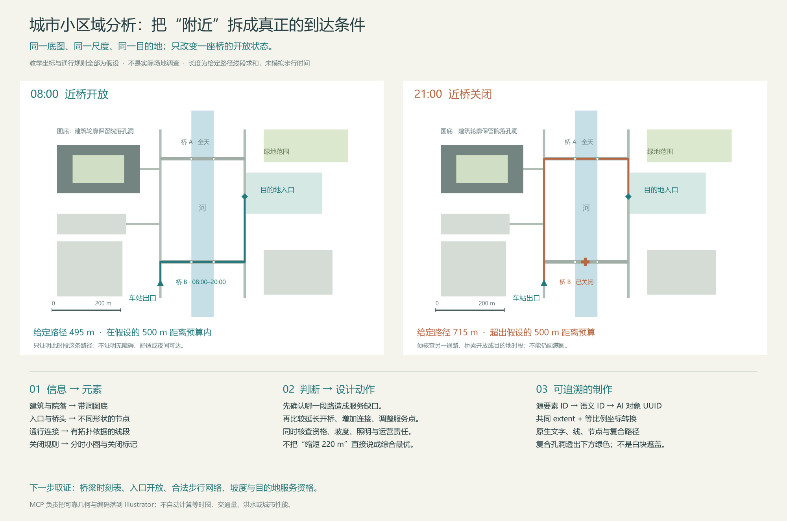

[繁體中文](README.md) · [简体中文](README.zh-CN.md) · [English](README.en.md) · [日本語](README.ja.md)

# Illustrator Architecture MCP

**`0.1.0-alpha.2` — 建筑与城市分析图的可编辑 Illustrator 工作流程。**

这个 fork 在通用 Illustrator MCP 之上，加入有证据依据的分析方法、底图坐标配准、语义覆盖图层与城市平面数据转换。它帮助你把“问题 → 证据 → 空间关系 → 图形表达 → 设计动作”落实成可修改的矢量与文字。

本 alpha 通过 [GitHub 公开 fork](https://github.com/Goku-Raku/illustrator-architecture-mcp) 与 [alpha Release](https://github.com/Goku-Raku/illustrator-architecture-mcp/releases/tag/v0.1.0-alpha.2) 提供**源代码与本地安装用 `.tgz`**；尚未上架 npm、MCP Registry 或插件市场。`private: true` 防止误发至 npm，不影响公开 fork 或本地安装。现有上游软件包与插件不会安装这个 fork。四份 README 同步维护；完整方法参考目前以简体中文为主。



*示例用于演示表达与工具流程，不是实测城市研究或 GIS 计算成果。*

下载：[安装包 `.tgz`](https://github.com/Goku-Raku/illustrator-architecture-mcp/releases/download/v0.1.0-alpha.2/illustrator-architecture-mcp-0.1.0-alpha.2.tgz) · [源代码 ZIP](https://github.com/Goku-Raku/illustrator-architecture-mcp/releases/download/v0.1.0-alpha.2/illustrator-architecture-mcp-0.1.0-alpha.2-source.zip) · [四语可编辑 AI 母版与 PNG](https://github.com/Goku-Raku/illustrator-architecture-mcp/releases/download/v0.1.0-alpha.2/illustrator-architecture-demo-masters-four-languages.zip) · [SHA-256 校验码](https://github.com/Goku-Raku/illustrator-architecture-mcp/releases/download/v0.1.0-alpha.2/SHA256SUMS.txt)。四语演示包含繁体中文、简体中文、英文与日语，均在 Illustrator 中制作。

## 提供什么

- **7 个建筑／城市工具**，可与现有 Illustrator MCP 搭配，也能单独提供完整工具集。
- **9 个按需读取的方法主题**、36 个建筑与场地分析切入点、40 个城市小区域分析维度，以及完整案例。
- 可编辑的色块、真正带孔洞的复合区域、折线／贝塞尔曲线、箭头、节点、扇形、边界、标注与简单斜线填充。
- 明确的文档身份、批次 ID、数据来源与证据状态；样式预检、执行后读回，以及失败恢复信息。

| 工具 | 功能与重要契约 |
| --- | --- |
| `arch_read_reference` | 读取实际画板／局部预览、文档身份与坐标框 |
| `arch_map_preview_points` | 将原始预览像素点换成指定画板的 pt 坐标 |
| `arch_add_overlay` | 在独立新图层建立有语义的原生可编辑元素 |
| `arch_inspect_elements` | 检查对象与语义；缺少识别 ID 时可能写入对象备注，因此不是纯只读操作 |
| `arch_style_elements` | 先预检，再批量修改受支持对象的样式并读回结果 |
| `arch_get_diagram_guidance` | 读取随软件包附带的方法文档；不启动 Illustrator |
| `arch_prepare_site_map` | 将已投影／本地平面要素转成等比例覆盖参数；保留来源 ID 与孔洞，不修改 Illustrator |

## 安装

需要 **Node.js 22 或 24**、npm，以及支持本地 stdio MCP 的客户端。实际绘图另需已安装、可打开的桌面版 Adobe Illustrator。本 fork 的实机证据来自 **Windows 与 Illustrator 26**；macOS 桥接继承自上游，但本 alpha 尚未实机验收。其他 Illustrator 版本亦待验证；较旧版本仍可能出现上游版本警告。详细结果见[验证记录](docs/VALIDATION-ALPHA.md)。

### 从源代码安装

克隆此公开 fork，或下载上述源代码 ZIP 后解压缩。

```sh
git clone https://github.com/Goku-Raku/illustrator-architecture-mcp.git
cd illustrator-architecture-mcp
npm ci
npm run build
npm test
npm run verify:offline
```

`verify:offline` 检查 ESM／bundle 启动、两种模式的工具列表、9 个方法主题及地图转换示例，**不启动或修改 Illustrator**。安装依赖仍需 npm registry 或可用缓存。不要跨操作系统直接复制 `node_modules`。

### 从下载的 `.tgz` 安装

在新的安装文件夹内执行，将示例路径换成实际下载位置：

```sh
npm init -y
npm install --omit=dev /absolute/path/illustrator-architecture-mcp-0.1.0-alpha.2.tgz
node node_modules/illustrator-architecture-mcp/scripts/verify-offline.mjs
```

这是本地归档文件安装，不是 npm 上架包的名称查询。源代码使用 `dist/index.js`；此方式使用 `node_modules/illustrator-architecture-mcp/dist/index.js`。保留各自完整的运行目录、依赖与附带的 `skills/`。

## 连接 MCP 与配套 skill

| 模式 | 设置 | 适用情境 |
| --- | --- | --- |
| `standalone`（默认完整模式） | `ILLUSTRATOR_ARCHITECTURE_ONLY=0` 或省略 | 由本 fork 提供 66 个基础工具与 7 个新增工具；避免同时启用重复的基础服务器 |
| `addon`（附加模式） | `ILLUSTRATOR_ARCHITECTURE_ONLY=1` | 只提供 7 个新增工具；保留现有 Illustrator MCP 负责打开文件、保存与导出 |

在源代码目录生成包含**这台电脑实际路径**的单个服务器 JSON：

```sh
npm run config:generate -- --mode standalone --output illustrator-architecture.server.json
```

已有基础服务器时改用 `--mode addon`。`.tgz` 安装则执行 `node node_modules/illustrator-architecture-mcp/scripts/generate-config.mjs`，并加上相同参数。生成器只建立新文件，不覆盖现有文件，也不更改任何客户端配置。检查内容后再由配置管理器导入；不要把含本地绝对路径的生成文件提交到公开仓库。

**使用 CC Switch 管理时：**先用你部署的管理脚本执行 `snapshot`。共享 skill 的唯一维护位置是 `~/.cc-switch/skills/architecture-diagramming`，客户端技能文件夹链接到此处；不要在全局 `.agents/skills` 再建立副本。更新完整 skill 后执行 `manage.ps1 -Action publish`，再执行 `-Action check`。MCP 使用已审阅的 JSON，经 `-Action set-mcp -McpId illustrator_architecture -SpecFile <绝对路径>` 发布。保留各客户端的启用／停用选择与原生运行配置。这些 `manage.*` 是部署者的管理层脚本，本软件包不附带，也不假定所有 CC Switch 安装都有它们。

未采用 CC Switch 管理的环境，可通过客户端支持的方式合并 MCP 配置，并安装完整 `skills/architecture-diagramming/` 到其支持的技能位置。**README 不会自动加载为操作规则；MCP 与 skill 必须分别配置。**详细步骤、配置示例与验收方式见[配套安装指南](AGENT_SETUP.md)。完成后在适当时机重新连接 MCP／重新加载技能，不自动中断进行中的工作。

## 使用方式

1. 先选择要判断的问题，区分观察、提供资料、推断与提案。
2. 读取真实底图预览；取点时使用返回图像的原始像素尺寸，经工具换算坐标。
3. 若使用地图数据，先确认投影、单位与 Y 轴方向，再以 `arch_prepare_site_map` 准备参数。
4. 在独立图层建立元素，保留来源与唯一批次 ID；修改前先预检。
5. 重新查看图面，检查配准、通行关系、遮挡、图例与文字，最后另存与导出。

> 请分析这个街区白天与夜间到公园的路径。先核对入口、跨河通道和开放时段；缺资料就标记未知。用同一范围、比例与图例比较，再用 Illustrator 建立可编辑的分析图。

方法入口：[建筑分析流程](docs/DIAGRAM-METHODOLOGY.zh-CN.md) · [城市小区域分析](docs/URBAN-SITE-ANALYSIS.zh-CN.md) · [图形与执行契约](skills/architecture-diagramming/references/mcp-execution.md)。

### 参考图拆解与风格复现

搭配能看图的代理，可以观察 Pinterest 等参考图的构图、线宽、配色、透明度、箭头、标注、图层，以及平面／剖面／轴测的表达方式，再用你的项目资料重新组织，在 Illustrator 制作可编辑的矢量与文字。流程是**参考观察 → 信息与图形映射 → 样式规格 → 制作 → 视觉与语义对照修正**；先用小范围样稿确认表达，再扩展到完整图面。

这是代理理解与工具绘制配合的工作流程，不是自动一键克隆。复杂三维几何需要 Rhino 或已有模型，照片与纹理需要额外素材；仅凭图片不能还原隐藏数据或准确计算。现有实机证据是四语矢量演示，尚未系统验证任意 Pinterest 图的风格复现。

## Alpha 边界与恢复

- 图片内的墙线仍是像素；不内置 OCR、图像分割、图片转 CAD 或自动房间识别。
- `arch_prepare_site_map` 不获取地图、不重投影、不计算路网等时圈、密度或水文。普通经纬度 GeoJSON 必须先转为明确的平面坐标。
- 扇形、箭头、节点与线宽是表达元素，不是日照、风场、人流或可达性计算；没有数据就不应补造北向、比例尺或量化结果。
- `compound_zone` 的洞必须严格在外框内，且互不接触、相交或嵌套；不进行几何布尔运算。样式工具只接受契约允许的对象，不能任意修改组或复合路径成员。
- 部分检查会为对象补写 ID 备注。所有连到同一 Illustrator 的服务器必须顺序操作，以免改到非预期文档。
- 通信失败若返回 `outcome_unknown:true`，先读回文档、图层与批次／对象状态，再决定如何恢复；不要直接重试写入或反复全局撤销。局部回滚不是跨进程事务保证。
- Alpha 的 API 与安装方式仍可能调整。离线检查通过，不等于实机几何、字体与输出已验收。

## 开发、验证与许可

```sh
npm ci
npm run build
npm test
npm run verify:offline
npm run verify:package
npm run release:check -- v0.1.0-alpha.2
```

`verify:package` 检查 `.tgz` 内容，并在干净的临时目录安装生产依赖、执行离线验证；可能需要网络或 npm 缓存。它不启动 Illustrator。实机测试会明确分开记录，请见[验证记录](docs/VALIDATION-ALPHA.md)。

Fork 与贡献时保留上游版权，新增测试，并同步这四份 README；提交问题时附版本、操作系统、Illustrator 版本及可复现步骤。来源为 [ie3jp/illustrator-mcp-server](https://github.com/ie3jp/illustrator-mcp-server)，基线 `57c5c101a5192c61535493f39b653e6f92b8eb29`（1.10.3）。本 fork 采用 [MIT 许可](LICENSE)，并非 Adobe 官方产品。

## 来源与使用说明

实际采用的程序库、建筑／城市方法及案例，以及各自的使用方式，见[来源与致谢](ACKNOWLEDGEMENTS.md)；其中区分代码依赖、方法参考与 Pinterest 阅图，没有把参考来源宣称为已集成的建筑数据库。

需求与建筑方向由项目发起者提出；本 fork 的新增代码与文档由 Codex 生成并协助迭代。上游作者与第三方来源的贡献另列于致谢与许可文件。

GitHub 提交归属与历史修正见[署名记录](https://github.com/Goku-Raku/illustrator-architecture-mcp/blob/main/ATTRIBUTION.md)；已发布的标签与下载附件保留原快照。

使用前请阅读[使用边界与免责声明](DISCLAIMER.md)、[上游沿革](UPSTREAM.md)、[隐私说明](PRIVACY.md)及[安全报告](SECURITY.md)。这些详细说明以繁体中文为主，免责与隐私文件另附英文摘要；软件的 MIT 许可不涵盖第三方地图、图片或字体。
